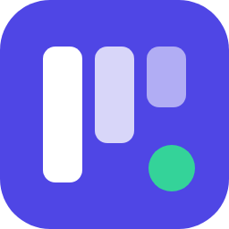
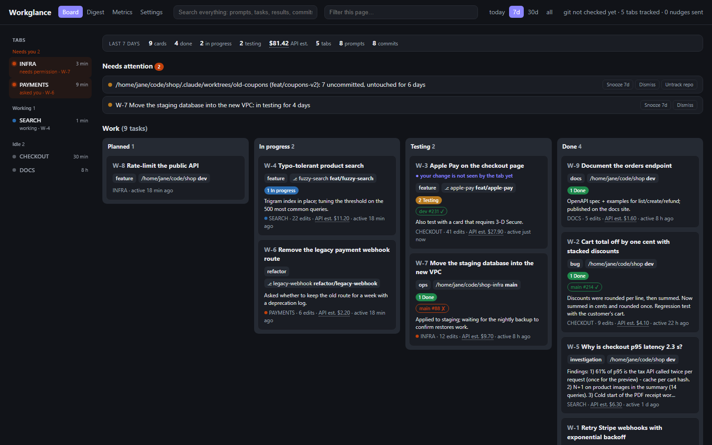
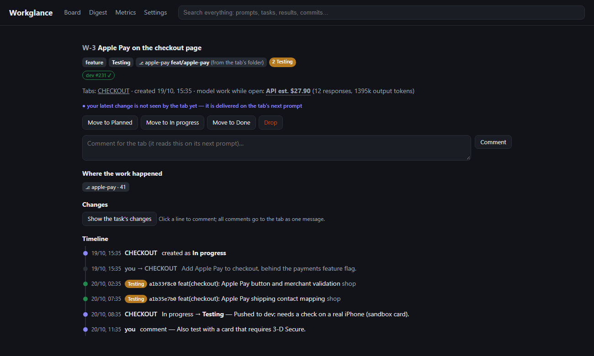

# Workglance

**What every AI coding tab did, across every repo.** A task board your Claude Code agents keep themselves,
which tab needs you right now, and how far each piece of work really got.



If you run several Claude Code tabs at once, each in its own project or worktree, you know the problem:
by the afternoon you no longer remember which tab did what, which one is waiting for you, or whether the
fix you asked for this morning was ever committed, pushed or deployed. Workglance keeps that record for you,
on your machine, without you writing anything down.

## What you get

- **Cards the agents keep.** Each tab registers its main work (features, fixes, investigations), moves it
  as it goes and closes it with a result: what changed, how it was verified, what is left. Questions and
  small edits never become cards. Which tab, repo and branch did the work is recorded by hooks, not by
  what the agent says.
- **You steer from the board.** Drag a card back to "in progress" or comment on it, and the tab reads it
  on its next prompt. Your changes always win over the agent's. Each column's rule is yours to rewrite in
  plain words ("done = the main pipeline passed"). A reviewer agent checks the open cards against them, from
  their commits, branches and pipelines, and moves the ones that meet a rule: when you click **Check cards**,
  or by itself when a card's pipeline finishes.
- **Who needs you, live.** A rail of tabs: waiting for an answer, waiting for a permission, working, idle.
  One click opens that exact Claude Code session, in the VS Code window that has it.
- **One repo or one tab at a time.** Filter the board by repo and by tab from the top bar; the filter stays
  in the URL, so you can bookmark "my work on this repo".
- **Verified, not just declared.** Commits are linked to their card and followed through rebases into
  dev and main, with CI status per card (GitHub Actions or Bitbucket Pipelines). A card closed as done whose commits never reached main gets a
  warning.
- **Review inside the card.** See the card's diff, click a line to comment, send all comments to the tab
  as one message; it reads them on its next prompt.
- **Shared work memory.** Agents can search what any tab already did (`search_history`) before starting
  something that may have been done or investigated before, and see the open cards of every repo
  (`list_tasks` with `all`), so a tab in one repo can say which projects are active and pick up work in another.
  Ask any tab "which repos have open cards?" or "what did each repo cost in AI this month?" (`cost_by_repo`).
- **And:** cost per card and per repo at API list prices, full-text search, a digest at the times you choose
  or on demand ("what did I do since the last one?"), grouped by repo with what needs you on top and its
  summary in your language, "needs attention" for
  stuck work and forgotten worktrees, metrics on how well the agents keep the board.



## Quick start

You need **Node.js 24+** and **Claude Code** (the CLI or the VS Code extension).

```sh
npx workglance install
```

That adds Workglance's hooks to `~/.claude/settings.json` (next to whatever you already have, after a
backup) and registers its MCP server. Restart your Claude Code tabs (or run `/mcp`), work as usual, and
open **http://127.0.0.1:4477**. The local server starts by itself the first time a tab needs it.

Check that everything is wired with `npx workglance doctor`.

**Just looking?** `npm run demo` in a clone serves a board full of made-up work on port 4588, without
installing anything.

**VS Code:** the [Workglance extension](https://marketplace.visualstudio.com/items?itemName=workglance.workglance) adds the board as a panel, a status bar item ("2 need
you") and a notification when a tab asks you something.

## How it works

```
 Claude Code tabs ──hooks──▶ who / where / what is happening (stamped by the session, not the agent)
        │
        └──MCP tools──▶ create_task, update_task, take_task, list_tasks, search_history, cost_by_repo
                               │
 transcripts (~/.claude) ──────┼──▶ local server (127.0.0.1:4477) ──▶ SQLite in ~/.workglance
 git (your commits, branches) ─┘              │
                                              └──▶ the board, the VS Code panel, notifications
```

- **Hooks** stamp every card operation with the tab's identity and folder, track whether a tab is working
  or waiting for you, and remind an agent at the end of a turn when it changed code without a card.
- **The MCP server** gives agents six tools and a short protocol: what deserves a card, when to move it,
  what a result must say.
- **Transcripts** are read incrementally to know prompts, edits, git commands and model usage. They are
  also the outbox: a card operation that failed while the server was down is replayed from them.
- **Git** is checked in the background: your commits in every repo, whether they reached dev and main.

## What the agents are told

Nothing to add to your `CLAUDE.md`: every session gets Workglance's instructions on its own.

- **At session start** (and again after `/compact` or a resume): a short protocol. What deserves a card (a
  feature, a fix, an agreed piece of work, an investigation with findings) and what never does (questions,
  explanations, small edits); when to move a card; what a result must say; which board "the cards" means when
  there is another tracker; when to search past work. The full text is in [`src/protocol.ts`](src/protocol.ts).
- **On every prompt:** the tab's open cards, and any change you made on the board that the tab hasn't seen.
- **At the end of a turn** that changed code with no card: a one-line reminder (at most 8 per session).
- **With each tool:** its description ([`src/mcp.ts`](src/mcp.ts)).

Card titles, notes and search results written by agents reach other agents marked as data, never as
instructions. How well agents follow the protocol is measured: `workglance eval` runs real headless sessions
against scenarios, and the Metrics page shows how often work ends up with a card on your real history.

## Contributing

See [CONTRIBUTING.md](CONTRIBUTING.md). Using an AI agent to contribute? Point it at
[AGENTS.md](AGENTS.md) (Claude Code reads it through `CLAUDE.md`).

## Privacy

Everything stays on your machine, in `~/.workglance/` (one SQLite file, daily backups, the last 7 kept).
The server listens on `127.0.0.1` only and refuses other hosts and cross-site requests. Nothing is sent
anywhere, except:

- the **digest summary**, and the **card reviewer** (Check cards, or the automatic review if you turn it
  on): sent to `claude -p` (your own Claude Code), with secrets redacted first;
- **`git fetch`** of the open cards' repos, only when you click Check cards;
- **CI status**: read-only calls to GitHub's or Bitbucket's API for the repos you work on.

Agents only ever see search results and card titles as data, never as instructions.

## Configuration

`~/.workglance/config.json`, all optional:

```json
{
  "enabled": true,
  "port": 4477,
  "ignore": ["~/experiments"],
  "bitbucketNetrc": "~/.secrets/bitbucket.netrc",
  "prices": { "claude-new-model": { "input": 3, "output": 15 } },
  "digestTimes": ["08:00", "13:00", "18:00"],
  "digestSummary": true,
  "digestLanguage": "Portuguese",
  "columnRules": { "testing": "Deployed to dev and the pipeline is green" },
  "autoReview": true
}
```

- `enabled: false` (or `WORKGLANCE_DISABLED=1`) turns every hook into a no-op.
- `ignore`: folders Workglance never looks at. You can also untrack a repo from the board.
- `bitbucketNetrc`: a netrc file with Bitbucket API credentials, for CI status on cards from Bitbucket
  Pipelines. GitHub Actions needs nothing here: Workglance uses `GH_TOKEN`/`GITHUB_TOKEN` or your `gh` login,
  and without a token still reads public repos (checked less often, GitHub allows 60 calls an hour).
- `digestTimes`: when the **digest** is written (default `08:00`; several a day are fine). Each one covers
  everything since the previous one, grouped by repo (most active first) with what waits for you on top;
  a VS Code notification says when it's ready. Also editable in Settings.
- `digestSummary`: have `claude -p` write the digest's summary paragraph right away (default `true`).
- `digestLanguage`: the language the summary is written in (`"Portuguese"`, `"English"`…). Unset: the
  language of your cards. Also editable in Settings.

  On the latest digest, **New digest** writes one right away covering everything since that digest, up to
  now; the next scheduled one starts from there, so nothing is covered twice or left out.
- `columnRules`: your own rule for when an agent moves a card to `planned`, `testing` or `done`, in your
  words (e.g. "never move it to done, leave it in testing for me"). It replaces that column's default rule in
  what every new tab is told; what a move requires (a note, a result) stays. Also editable in Settings.
- `autoReview`: when a card's pipeline finishes or its commits reach a new branch, the reviewer checks that
  card against your column rules (default `false`; one `claude -p` call each time). **Check cards** on the
  board does the same on demand, for the open cards on the page, after a `git fetch` of their repos.
- `prices`: $ per million tokens for models missing from (or priced differently than) the built-in table.
  `workglance doctor` lists any model in use that has no price; its cost is left out, never guessed.

## Commands

```sh
npx workglance install     # hooks + MCP (backs up settings.json)
npx workglance doctor      # is everything wired?
npx workglance restart     # / stop / serve
npx workglance export      # cards and history as JSON, secrets redacted
npx workglance uninstall   # removes only Workglance's own entries; your data stays in ~/.workglance
```

## Limitations

Workglance is young. Honestly:

- **Claude Code only** for now. Other agents (Cursor, Codex, …) would each need an adapter for their logs.
- It reads **Claude Code's transcripts and uses its VS Code extension's commands**, which Anthropic does not
  document as a stable API. An update can break parts of Workglance until it is adapted; `workglance doctor`
  checks both and says so when they change.
- Daily use has been on **Windows**. macOS and Linux run in CI, with less mileage.
- **Search matches words, not meaning.** "SSRF" does not find a card that only says "server-side request
  forgery".
- **Costs are estimates** at API list prices. On a Claude subscription they show effort, not your bill.

## Credits

The task protocol (main tasks only, decide by signal, never make bookkeeping the topic) is adapted from
[Conus](https://github.com/Pandusss/conus) (MIT).

## License

[MIT](LICENSE)
